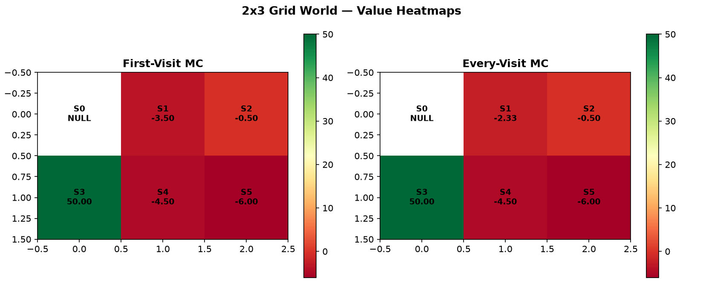
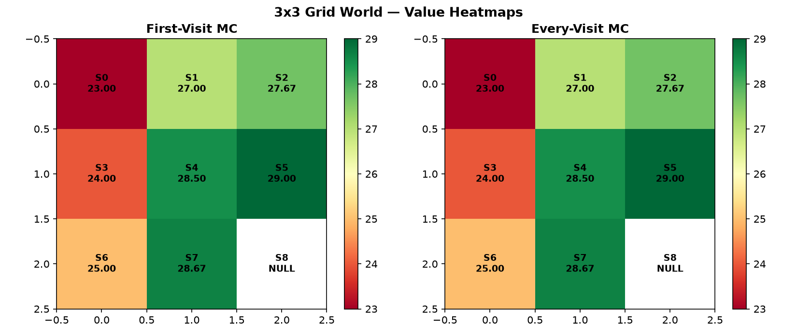

# Monte Carlo Methods: First-Visit vs. Every-Visit Policy Evaluation

[](https://www.python.org/)
[](https://jupyter.org/)
[](https://numpy.org/)
[](https://matplotlib.org/)
[](https://opensource.org/licenses/MIT)

## Author
- **Shrri Dharshan D R** — [@shrridharshan27](https://github.com/shrridharshan27)
- **Registration Number:** 23BPS1090
- **Course:** Reinforcement Learning Lab (BCSE432E)
- **Lab Slot:** L31+L32

---

## Overview
This repository implements model-free **Monte Carlo (MC) Methods** in Reinforcement Learning to estimate state-value functions $V(s)$ without requiring prior transition probability matrices. The project benchmarks:
1. **First-Visit Monte Carlo:** Updates state value $V(s)$ using only the first occurrence of state $s$ in an episode.
2. **Every-Visit Monte Carlo:** Updates state value $V(s)$ using returns from every time state $s$ is visited in an episode.

Tested on an illustrative 4-state line trajectory ($\gamma = 0.9$), and both $2 \times 3$ and $3 \times 3$ GridWorld environments ($\gamma = 1.0$).

---

## Mathematical Formulation

### 1. Cumulative Discounted Return ($G_t$)
$$G_t = \sum_{k=t}^{T-1} \gamma^{k-t} R_{k+1}$$

### 2. First-Visit MC Value Estimator
$$V(s) = \frac{1}{N_{\text{first}}(s)} \sum_{i=1}^{N_{\text{first}}(s)} G_{t_i}(s)$$
Where $t_i$ denotes the first time-step state $s$ was reached in episode $i$.

### 3. Every-Visit MC Value Estimator
$$V(s) = \frac{1}{N_{\text{all}}(s)} \sum_{j=1}^{N_{\text{all}}(s)} G_{t_j}(s)$$
Averages returns across all occurrences of $s$ in all episodes.

---

## Experimental Results




### Part 1: Infographic Trajectory ($\gamma = 0.9$)
- **Episode:** $S_0 \xrightarrow{a_0, -1} S_1 \xrightarrow{a_1, -1} S_2 \xrightarrow{a_2, +2} S_3 \xrightarrow{a_3, +5} \text{Terminal}$
- $G_0(S_0) = -1 + 0.9(-1) + 0.81(+2) + 0.729(+5) = \mathbf{3.365}$
- $G_1(S_1) = -1 + 0.9(+2) + 0.81(+5) = \mathbf{4.850}$
- $G_2(S_2) = +2 + 0.9(+5) = \mathbf{6.500}$
- $G_3(S_3) = +5 = \mathbf{5.000}$

### Comparative Analysis: First-Visit vs Every-Visit
- When episodes do not contain state cycles, First-Visit and Every-Visit yield identical estimates.
- When an episode loops back to a visited state, Every-Visit incorporates multiple returns from a single rollout, introducing slight bias in finite samples but converging asymptotically to $V^\pi(s)$.

---

## Project Structure
```text
Monte-Carlo-Methods-RL/
├── monte_carlo/
│   ├── __init__.py
│   └── simulator.py     # MonteCarloSimulation class & return calculations
├── assets/
│   ├── 2x3_grid_heatmap.png
│   └── 3x3_grid_heatmap.png
├── 23BPS1090_ShrriDharshan_RL_Lab5.ipynb
├── main.py              # Full execution & tabular comparison
├── requirements.txt
├── .gitignore
├── LICENSE
└── README.md
```

---

## Quickstart & Setup

1. **Clone repository:**
   ```bash
   git clone https://github.com/shrridharshan27/Monte-Carlo-Methods-RL.git
   cd Monte-Carlo-Methods-RL
   ```

2. **Install requirements:**
   ```bash
   pip install -r requirements.txt
   ```

3. **Run simulation:**
   ```bash
   python main.py
   ```

4. **Launch Jupyter Notebook:**
   ```bash
   jupyter notebook 23BPS1090_ShrriDharshan_RL_Lab5.ipynb
   ```

---

## License
Distributed under the [MIT License](LICENSE).
